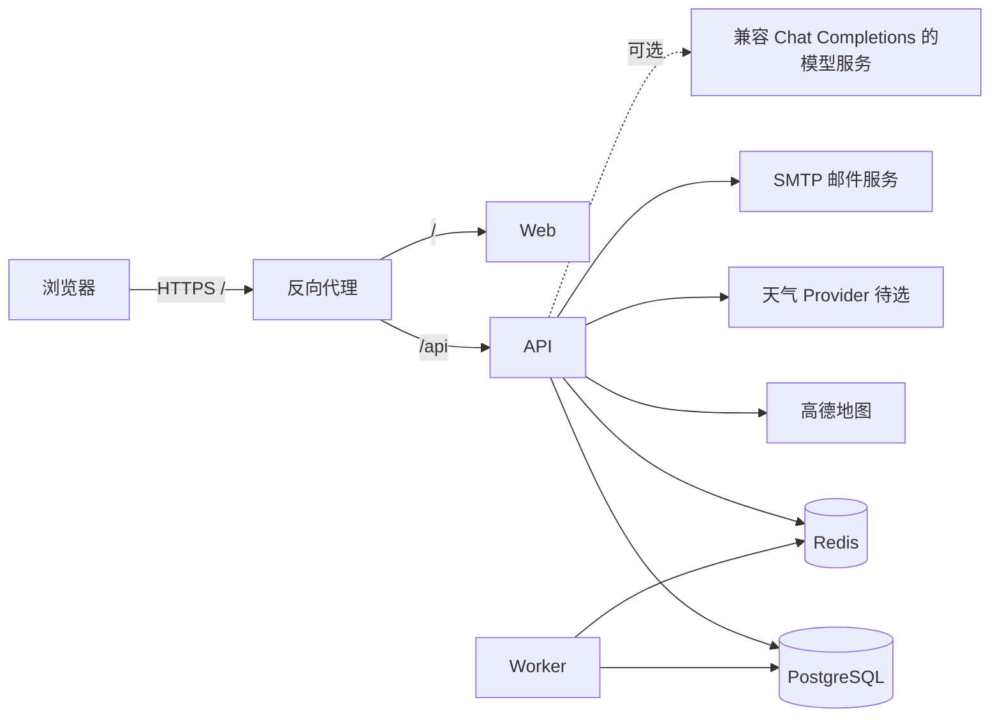

# 生产部署与外部服务接入设计

状态：产品边界和目标架构已确定；云平台、邮件商、天气 Provider、预算和保留期限待后续选择。本文描述目标，不代表生产环境已经部署或外部凭据已验证。

旅行动态媒体支持本地目录和 S3 兼容私有对象存储。开发默认使用 `.data/media`；生产配置必须设 `MEDIA_STORAGE_BACKEND=s3` 和 `MEDIA_S3_BUCKET`。仓库提供可选 SeaweedFS Docker 开发服务，Apache-2.0 许可且提供 S3 API；其官方项目文档包含单机 `weed mini`/Docker 启动方式与 S3 endpoint `:8333`。选择它作为本地适配验收服务；生产供应商仍需独立评估。AWS 部署可使用运行角色凭据，其他兼容服务配置专用访问密钥。对象不设公开 ACL，读取始终经 API 登录态与动态可见权限检查。当前上传、下载和删除适配已实现，但真实云端兼容性、生命周期/备份策略和故障演练仍须在选定供应商后验收。

本地对象存储启动：`docker compose --profile media up -d seaweedfs`。将 `.env` 中 `MEDIA_STORAGE_BACKEND` 改为 `s3`，开发桶、endpoint 与凭据使用 `.env.example` 中的 SeaweedFS 示例值，然后重启 API。只把对象 API 绑定到 loopback；不要把示例凭据用于生产。

## 首发运行边界

- 首发为邀请码控制的多用户封闭试用，单区域部署，不承诺 SLA。
- Web、API、Worker 分开运行；PostgreSQL 和 Redis 使用受控托管服务或私有网络服务。
- 一个 HTTPS 域名作为浏览器入口：`/` 路由到 Web，`/api` 路由到 API。浏览器会话只通过 HTTPS Cookie 传递；跨账户资源继续由 API 按所有者隔离。
- 数据库、Redis 不暴露公网端口。API 与 Worker 使用各自最小权限凭据；迁移使用独立部署步骤。
- 生产密钥来自部署平台的 Secret 配置，不写入镜像、仓库、前端变量或普通日志。
- 当前 `docker-compose.yml` 是本地开发依赖配置，不是生产部署方案。`/health` 只报告 API 进程存活；`/ready` 检查数据库连通性、数据库迁移 revision 与 Redis 队列；独立的 `/ready/worker` 检查 Redis 中是否存在有效 Worker 心跳。检查失败均返回 503，但 API 通用 readiness 不依赖 Worker 心跳。API 运行镜像需包含 `alembic.ini` 和迁移脚本；生产部署前仍需完成备份恢复演练。
- 反向代理必须覆盖并重新设置转发头。Uvicorn 只信任实际代理的固定 IP/CIDR，例如 `uvicorn travelpilot_api.main:app --proxy-headers --forwarded-allow-ips=10.0.2.10,10.0.2.0/24`；将示例替换成部署网络中的精确代理地址，禁止使用 `*` 或直接信任公网客户端传来的 `X-Forwarded-For`。若平台代理地址会变化，应使用平台提供的可信代理网段或网络边界隔离后再配置。

## 外部服务边界

| 能力 | 当前实现 | 首发设计 | 故障时行为 |
|---|---|---|---|
| 地图、POI、路线 | Fake 与高德适配器；支持搜索、详情、驾车路线和距离矩阵。高德 key 仅由 API 读取；超时默认 8 秒。查询结果在每个 API 进程内缓存 10 分钟。 | 中国大陆首发以高德为真实 Provider；Fake 只用于开发和验收。生产必须显式配置真实 Provider 与 key，不静默回退到 Fake。缓存键包含 Provider 和查询参数；后续多实例部署改为共享缓存，并按 Provider 配额控制并发和请求量。 | 上游超时、配额耗尽、格式错误都映射为可识别的 Provider 故障；错误结果不缓存。地图不可用时允许查看已保存旅行，但不生成依赖实时路程的新计划，并给出重试提示。 |
| 天气 | `OpenMeteoProvider` 已接入旅行详情和顾问草案；返回预报时段、更新时间、来源与署名。无 API Key。`WEATHER_CHANGE` 仍是用户手动模拟事件，不代表天气观测。 | 当前 Open-Meteo 只用于本地非商业试用并显示数据来源；公开或商业部署前需复核服务条款并选择有合适许可/预算的供应商。QWeather 可作为中国地区后续评估对象，不能当作当前 Provider。天气只作提示，不作为不可绕过的硬约束。 | 上游超时、无覆盖和无效响应均显示天气不可用或预报范围不足，不伪装为真实预报；手动天气事件仍标为“模拟”。生产环境仍需对所选供应商验证有效期、配额和故障路径。 |
| 邮件 | 注册验证、重置密码和 SMTP 配置已实现；开发模式使用进程内临时调试邮箱。 | 生产接入 SMTP relay。验证邮件 24 小时有效；密码重置邮件 1 小时有效且一次使用。发信额度、发送退避和供应商由部署前确定。 | 发信失败需允许重新发送并向用户给出可恢复提示；重置申请使用统一响应，避免泄露账户是否存在。 |
| 文本模型 | 可选 OpenAI-compatible Chat Completions；无凭据时使用保守本地抽取。 | 模型只用于结构化建议，排程硬约束由本地确定性规划器处理。明确告知用户哪些输入会发送至外部模型；秘钥只放 API。首发可关闭模型，核心流程仍可用。 | 超时、不可用、格式不合法时转本地抽取或提示重试；不丢失用户原文，不把模型输出直接当作确认地点。 |

## Provider 开源与费用调研

以下为 2026-10-16 查阅官方页面得到的选型参考，价格、额度和许可可能调整；采购/接入时仍需在控制台复核并保存条款版本。

### 地图

当前 Web 已使用地图数据 API 做 POI 搜索和规划，但没有真正的地图画布/瓦片展示。设计上把“地图数据服务”和“地图可视化 SDK/瓦片”拆成两项：首发先保持列表化地点搜索和路线时间约束；下一版在旅行详情/计划页增加 POI 标记与当天顺序连线。优先评估高德 JS API 2.0；它需要独立 Web(JS API) Key，生产环境按高德文档配置域名限制和安全代理，JS 安全密钥留在服务端，不能当成 Web Service Key 复用或直接塞进前端。[JS API 快速上手](https://lbs.amap.com/api/javascript-api-v2/getting-started)、[JS API 安全密钥指南](https://lbs.amap.com/api/javascript-api-v2/guide/abc/jscode)。若未来选择 MapLibre 等开源渲染器，还必须单独选择、部署并许可瓦片/样式数据；渲染库本身不提供地图数据。

| 选项 | 能力与条件 | 对 TravelPilot 的适配判断 |
|---|---|---|
| 高德 Web 服务 API | 官方提供 POI 搜索、路线规划、天气查询和调用限制/计费说明。当前定价页列出的基础 LBS 与搜索服务参考价为 ¥30/万次起，超出月配额后按流量包或余额扣费；免费月配额与 QPS 按服务类型、开发者认证和许可情况不同，不能把“有 Key”视为无限免费或已获商用授权。[官方服务概览](https://lbs.amap.com/api/webservice/summary/)、[基础服务计价与配额](https://lbs.amap.com/pages/base_service_price)、[Key 申请与接入](https://lbs.amap.com/api/webservice/gettingstarted?type=spa) | 继续作为中国大陆首发主地图。现有适配器覆盖主要行程功能；上线前必须用项目对应的 Key/认证查看实际配额、许可和账单。 |
| OSM + Nominatim + OSRM 自托管 | Nominatim 可做地名/POI 搜索；OSRM 是 BSD-2-Clause 开源路网路由引擎，支持驾车/骑行/步行和矩阵类查询。[Nominatim 项目](https://github.com/osm-search/Nominatim)、[OSRM 项目与许可](https://project-osrm.org/)。OpenStreetMap 数据适用 ODbL，需处理署名及数据库派生/共享义务。OSM 官方公共 Nominatim 实例最高 1 请求/秒，禁止自动补全和系统性抓取，因此不能作为生产免费 API；自托管不收 API 调用费，但需要导入数据、运维存储和验证中国重点城市覆盖。[公共服务政策](https://operations.osmfoundation.org/policies/nominatim/) | 可作为开发比较或未来独立替代 Provider，不建议在首发生产中与高德实时混用：覆盖质量、坐标体系、数据许可和运行维护尚未验收。开源软件不等于托管服务免费。 |

高德规定其开放平台使用 GCJ-02 坐标；OSM 路网采用 OSM 数据坐标。首发地图设计应要求地点坐标标记来源/坐标系，进入 Provider 前校验和转换；不得把两种坐标裸值直接混算或在故障时跨 Provider 自动回退。[高德坐标系说明](https://lbs.amap.com/faq/advisory/others/39838)

### 天气

| 选项 | 开源/服务/价格信息 | 对 TravelPilot 的适配判断 |
|---|---|---|
| Open-Meteo | API/服务端代码开源 AGPLv3，天气数据 CC BY 4.0（需署名）。公共免费 API 面向非商业用途，当前列出 10,000 次/日且无 SLA；商业使用需订阅。可自托管，但官方指南给出的建议服务器规模约 8 GB 内存、100 GB 存储，并要准备天气模型数据和缓存。[许可与商用定价](https://open-meteo.com/en/pricing)、[自托管指南](https://github.com/open-meteo/open-meteo/blob/main/docs/getting-started.md) | 适合本地原型/离线评估；公开多用户产品不能默认依赖其免费公共服务。自托管虽可商用，但对当前 MVP 的运维成本偏高，且需遵守 AGPL 与数据署名。 |
| 和风天气 QWeather | 每日预报接口当前支持最多 10 天；按量计费官方页列出每月前 5 万次 ¥0，接下来 95 万次 ¥0.0007/次，后续阶梯递减；另有免费订阅规格。使用须遵守许可及来源署名要求。[每日预报文档](https://dev.qweather.com/docs/api/weather/weather-daily-forecast/)、[当前按量价格](https://dev.qweather.com/docs/finance/pricing/)、[订阅与规格](https://dev.qweather.com/docs/finance/subscription/) | **建议作为真实天气首选评估对象**：中国城市场景、预报字段和 10 天范围更贴合行程；先按量接入并设置应用侧预算告警。实际调用计费方式、免费额度适用范围和署名呈现应在创建项目时复核。 |
| 高德天气 API | 可复用现有高德 Web 服务 Key；官方接口返回实况与未来 3 天预报，文档以 `reporttime` 标示更新时间。定价页列天气参考价 ¥30/万次，并按开发者类型列月配额。[天气接口文档](https://lbs.amap.com/api/webservice/guide/api/weatherinfo)、[配额与价格](https://lbs.amap.com/pages/base_service_price) | 集成最省，但仅 3 天，不适合较早规划更远的旅行；可先用于短期天气提示，或与 QWeather 做过相同验收后择一，不在同一页面拼接来源不一致的数据。 |

**当前选择与生产边界：**本地试用地图使用高德 Web 服务 Provider，天气使用 Open-Meteo 公共 API；地图和天气真实接口已完成本地浏览器验收。Open-Meteo 免费公共服务限非商业使用且无 SLA，因此该验收不构成对外多用户或商业生产许可。生产部署前需根据用途选定 Provider、复核许可/配额，并在目标环境完成故障与费用验收。QWeather 和高德天气仅为备选评估，不代表已接入天气链路。

预算估算使用实际产品动作而不是单纯账户数：例如规划一次会触发多少次矩阵/天气请求、缓存能合并多少重复查询、用户主动刷新频率是多少。上线前先设置按月调用上限告警，达到阈值时停止非必要刷新并显示缓存/不可用状态，不让 Provider 账单失控。

## 数据、日志和恢复

- PostgreSQL 保存账户、旅行及计划的权威数据；Redis 保存后台队列、短期 IP 限流计数和滚动邮件发送预算，不作为长期事实来源。Redis 不可用时公开认证入口拒绝处理，避免故障时无保护放行。
- 日志记录请求 ID、路由模板、状态码、耗时和 Provider 错误类别；不得记录密码、Cookie、Bearer token、邮件验证/重置链接、攻略原文或记忆文本。
- API 对 HTTP 429 和 5xx 另记 `security_event=rate_limited` / `security_event=server_error` 警告事件，字段仅含请求 ID、方法、路由模板和状态码。部署侧可按事件字段接入日志告警；目前尚无告警平台、阈值、通知渠道或值班人配置。
- 账户删除执行数据库级联规则；备份按单独保留策略过期，不承诺删除后立即从既有备份物理消失。对用户展示清晰的数据删除与备份保留说明。
- 2026-10-16 已在本地 Docker PostgreSQL 完成逻辑备份到临时文件、恢复到隔离数据库、核对 Alembic revision 和核心表行数的演练；临时数据库与 dump 已清理。生产备份频率、加密存储、保留周期、RPO/RTO 仍需在选定托管平台后确定，并使用正式备份任务再次演练。
- Worker 任务应能识别重复投递，失败任务有有限重试和可查状态；Redis 清空后可依据数据库状态安全恢复或重建必要任务。
- Worker 每 15 秒更新一个 45 秒 TTL 的独立 Redis 心跳，优雅退出时删除自己的心跳；多个 Worker 实例可独立报告。认证数据清理与队列消费共用 Worker 进程；若 Worker 停止，清理会在其恢复时继续执行，因此生产环境应监控 `/ready/worker`、Worker 错误日志和队列积压。

数据类别、当前删除行为和建议保留期限见 [`../security/data-lifecycle.md`](../security/data-lifecycle.md)。其中期限均为待产品确认的建议，不代表系统已自动清理或生产备份已配置相应生命周期。

## 外部 Provider 的验收边界

- **高德**：在真实部署环境验证 POI 搜索、详情、路线和矩阵；检查空结果、超时、无效 key、配额错误和响应字段缺失；验证错误未被缓存、日志不含 key；记录调用量和费用归属。
- **天气**：Provider 选定后，用固定响应夹具覆盖有预报、无覆盖、超期、超时和上游错误；检查前端能区分真实预报、过期数据、不可用和用户模拟事件。离线用例不算真实供应商联调。
- **邮件**：用真实收件邮箱验证注册、验证链接过期/重复使用、重发、账户枚举保护、重置过期/重复使用和旧会话撤销；验证退信/暂时失败的恢复路径。
- **模型**：分别验证无 Key、本地回退、上游超时和格式错误；记录调用耗时与成本，不把用户秘密发送给模型。
- 所有 Provider key 留在服务端；每个 Provider 有单独超时、配额/限流、错误分类和可关闭开关。任何外部服务不可用都不能绕过账户隔离或数据所有权校验。

## 分阶段开放

1. **本地阶段**：Fake 地图、开发邮箱、天气明确不可用；CI 覆盖 API 与 UI，不宣称真实 Provider 已验收。
2. **封闭预发**：部署目标拓扑；启用 HTTPS、真实 SMTP 和高德；天气 Provider 选定后再启用。完成备份恢复、日志脱敏、限额和故障注入验收。
3. **邀请码试用**：少量用户、明确数据用途和保留说明；监控 Provider 配额、邮件送达、API 错误率和 Worker 积压；达到稳定门槛后再评估公开注册。

## 后续待定

云部署平台及区域、天气供应商、SMTP 商、预算与配额、备份保留期限/RPO/RTO、邮件和地图调用限额、天气预报有效范围、服务可用性目标，以及高德坐标体系与手工录入坐标之间的规范化规则。首轮设计不提前假定这些具体值。
